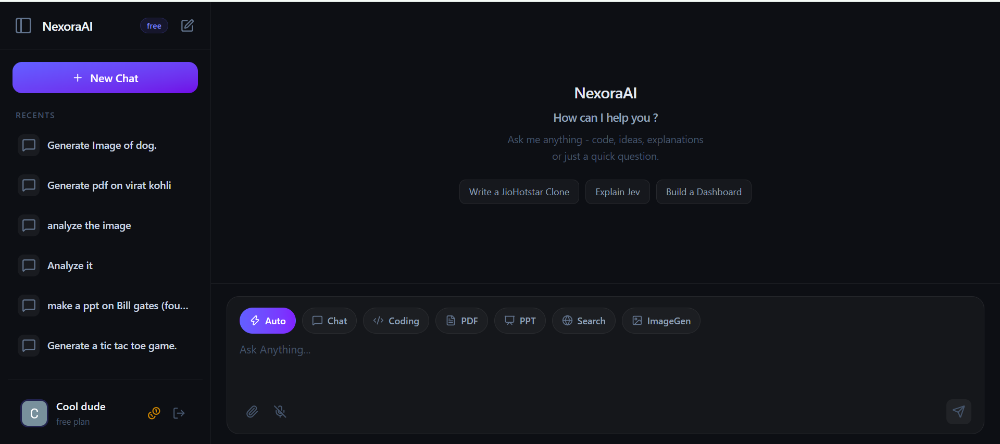
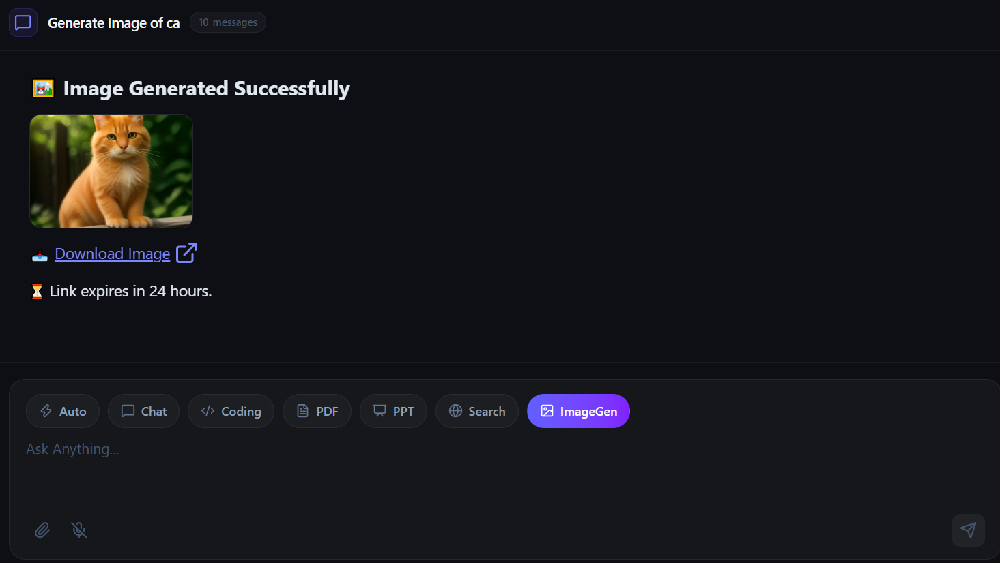
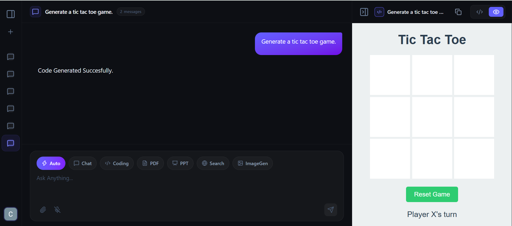
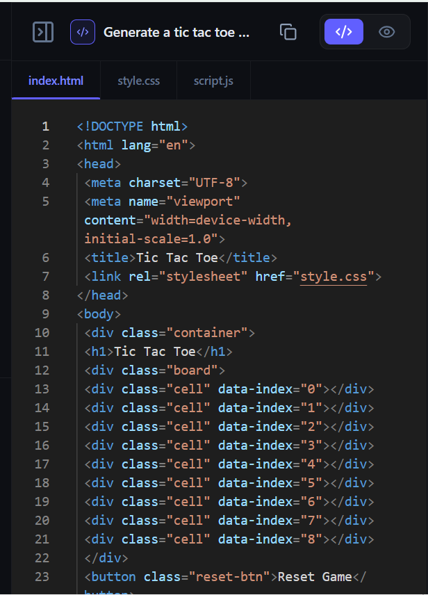
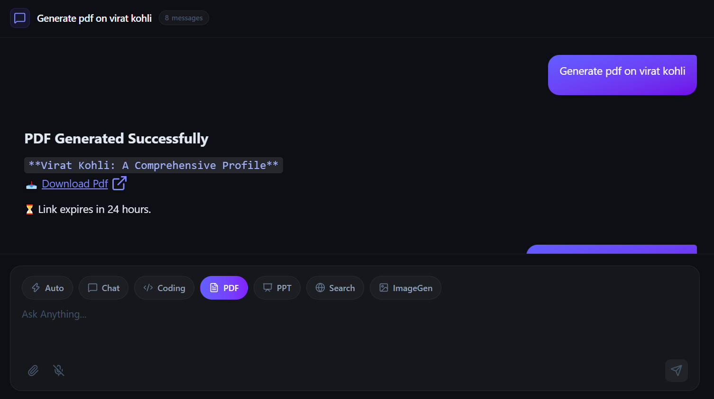
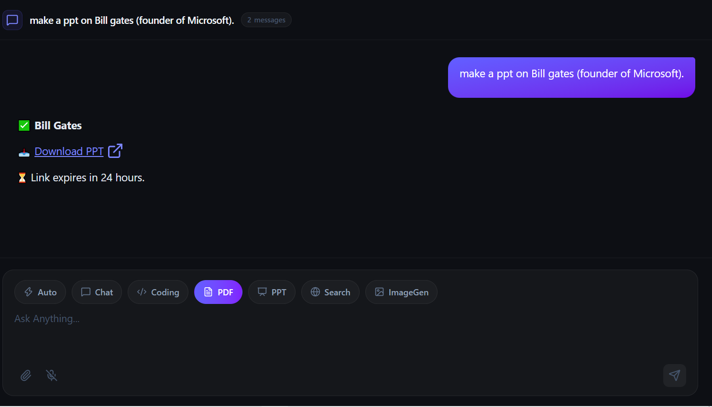

# Nexora AI — Multi-Agent AI Platform

Nexora AI is an enterprise-ready, multi-agent AI platform built using the **MERN Stack**, **Microservices Architecture**, **LangGraph**, **Redis**, **Docker**, and **AWS**. It features an intelligent **Router Agent** that dynamically orchestrates user requests across specialized AI agents.

---
### 🔗 Live Link

https://d3d95kwsm7a73p.cloudfront.net
---
## 📸 Screenshots & Preview

### 1. Main Dashboard & Agent Hub


### 2. Multi-Agent Conversation & Image Gen Agent


### 3. Interactive Code Sandbox & Artifact Preview




### 4. PDF & PPT Document Generation




---

## ✨ Key Features

- **Dynamic Agent Routing**: LangGraph-powered Router Agent automatically evaluates intent and directs prompts to specialized agents.
- **Specialized AI Agents**:
  - **💬 Chat Agent**: General conversational AI with sliding-window memory.
  - **🌐 Search Agent**: Real-time web search and media extraction using Tavily Search API.
  - **💻 Coding Agent**: Multi-file code generation (HTML, CSS, JS) with live browser sandbox previews.
  - **📄 PDF & PPT Agents**: Automated document generation stored on cloud storage.
  - **🎨 Vision & Image Agent**: Custom AI image generation and image analysis.
- **Microservices Architecture**: Independent services for Gateway, Auth, Chat, Agent, and Billing.
- **Redis Session & Memory**: High-performance session validation and conversation history caching.
- **Google Auth**: Secure authentication via Firebase Google Auth.
- **Monetization**: Credit billing and subscription plans integrated with Razorpay.
- **Containerized Infrastructure**: Docker Compose local environment with MinIO (S3 compatible) and AWS ECR/ECS support.

---

## 🏗️ Architecture

```
                      ┌──────────────────────┐
                      │   React + Vite UI    │
                      └──────────┬───────────┘
                                 │
                                 ▼
                      ┌──────────────────────┐
                      │     API Gateway      │ (Port 8000)
                      └──────────┬───────────┘
                                 │
     ┌───────────────────┬───────┴───────────┬───────────────────┐
     ▼                   ▼                   ▼                   ▼
┌─────────┐         ┌─────────┐         ┌─────────┐         ┌─────────┐
│  Auth   │         │  Chat   │         │  Agent  │         │ Billing │
│ Service │         │ Service │         │ Service │         │ Service │
│ (8001)  │         │ (8002)  │         │ (8003)  │         │ (8004)  │
└────┬────┘         └────┬────┘         └────┬────┘         └────┬────┘
     │                   │                   │                   │
     └───────────────────┴─────────┬─────────┴───────────────────┘
                                   │
                     ┌─────────────┴─────────────┐
                     ▼                           ▼
            ┌─────────────────┐         ┌─────────────────┐
            │   MongoDB DB    │         │   Redis Cache   │
            └─────────────────┘         └─────────────────┘
```

---

## 💻 Tech Stack

- **Frontend**: React (Vite), Tailwind CSS, Redux Toolkit, Lucide Icons
- **Backend**: Node.js, Express.js (Microservices)
- **AI & Orchestration**: LangGraph, LangChain, Tavily API, Groq, Gemini, DeepSeek
- **Databases & Cache**: MongoDB Atlas, Redis (Docker)
- **Storage & Auth**: AWS S3 / MinIO, Firebase Authentication
- **Payments**: Razorpay Node.js SDK
- **DevOps & Cloud**: Docker, Docker Compose, AWS ECR/ECS, GitHub Actions CI/CD

---

## ⚙️ Quick Start

### Prerequisites
- Node.js (v18+)
- Docker & Docker Desktop
- MongoDB Atlas Connection String
- Free API Keys: Groq, Google AI Studio, Tavily, Firebase

### 1. Start Docker Infrastructure
```bash
cd Backend
docker compose up -d
```

### 2. Configure Environment Variables (`.env`)
Set `.env` files for `gateway`, `auth`, `chat`, `agent`, and `billing` services with your MongoDB URI, Redis URL (`redis://localhost:6379`), and API keys.

### 3. Launch Services
```bash
# Gateway (Terminal 1)
cd Backend/gateway && npm install && npm run dev

# Microservices (Terminals 2-5)
cd Backend/services/auth && npm run dev
cd Backend/services/chat && npm run dev
cd Backend/services/agent && npm run dev
cd Backend/services/billing && npm run dev
```

### 4. Run Frontend
```bash
cd Frontend
npm install
npm run dev
```
Open `http://localhost:3000` in your browser.

---

## 📜 License

Distributed under the MIT License.
